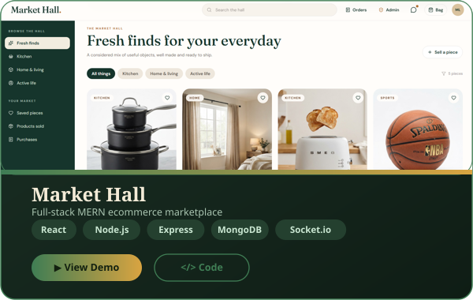
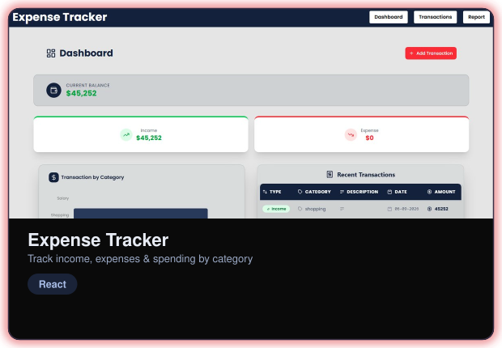
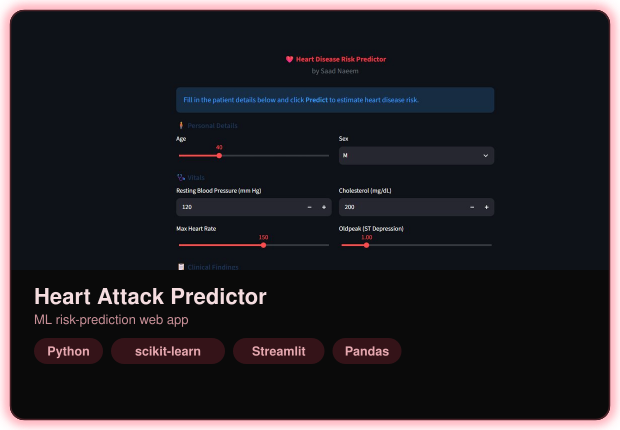
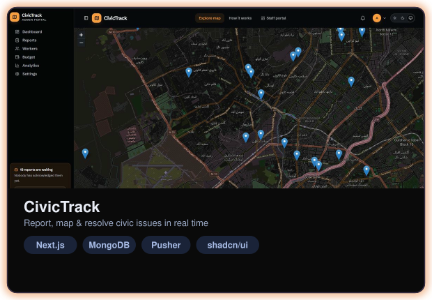
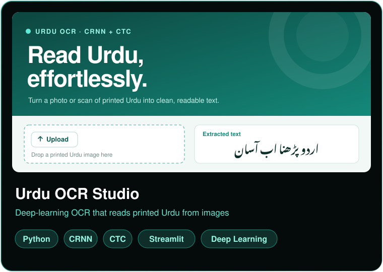

<!-- ⚠️ Keep your existing header / banner / stats section from your current README above this line if it has more than what's here. -->

---

## 🛠️ Tech Stack

### Languages & Frameworks

### Python, Data Science & Machine Learning

### Databases

### Tools & Platforms

---

## 🚀 Projects

<table>
  <tr>
    <td width="50%" align="center" valign="top">
      
       
      
      
    </td>
    <td width="50%" align="center" valign="top">
      
       
      
      
    </td>
  </tr>
  <tr>
    <td width="50%" align="center" valign="top">
      
       
      
      
    </td>
    <td width="50%" align="center" valign="top">
      
       
      
      
    </td>
  </tr>
  <tr>
    <td width="50%" align="center" valign="top">
      
       
      
      
    </td>
    <td width="50%"></td>
  </tr>
</table>
